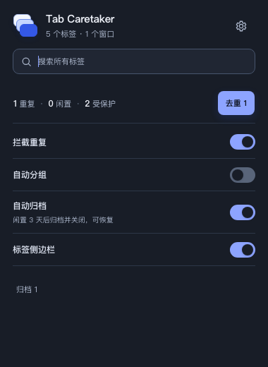

# Tab Caretaker（标签管家）

[](https://github.com/halvee-tech/tab-caretaker/actions/workflows/ci.yml)
[](https://github.com/halvee-tech/tab-caretaker/releases/latest)
[](LICENSE)
[](https://developer.chrome.com/docs/extensions/develop/migrate/what-is-mv3)
[](https://chromewebstore.google.com/detail/tab-caretaker/bdegmnmphdkbnooonojbhobpiipgfncb)

一个本地优先的 Chrome 标签管理扩展：拦截无意产生的重复标签、按域名整理标签、跨窗口搜索，并在关闭长期闲置页面前安全归档。

> Local-first Chrome extension for deduplicating, grouping, searching, and safely archiving tabs. English overview is available below.

**已上架 Chrome 应用商店：[一键安装 Tab Caretaker](https://chromewebstore.google.com/detail/tab-caretaker/bdegmnmphdkbnooonojbhobpiipgfncb)**



## 为什么做它

当浏览器里同时存在几十个标签时，真正麻烦的通常不是“打开”，而是重复、查找、整理和安全关闭。Tab Caretaker 将这些操作放在一个轻量插件中，并遵循三个原则：

- 自动化不剥夺控制权；所有改变浏览器状态的自动功能默认关闭。
- 有意复制的标签应保留，无意重复的标签才拦截。
- 自动关闭前先本地归档，并尽量让操作可恢复。

## 主要功能

- **重复标签拦截**：再次打开相同地址时切回原标签，并对用户明确复制的场景提供例外。
- **一键清理已有重复标签**：批量去重，并保留撤销能力。
- **按域名分组**：可手动启用自动分组，保留用户自定义名称；关闭开关时解除当前分组。
- **跨窗口搜索**：在弹窗中搜索并切换到任意已打开标签。
- **标签侧边栏**：以 Chrome 原生侧边栏展示分组和未分组标签，悬停标签行即可点击关闭。
- **安全归档**：默认以 3 天为闲置阈值，先保存本地记录再关闭，可搜索和恢复。
- **保护规则**：活动、固定、播放媒体、手动保护和白名单标签不会被自动归档。
- **自适应主题**：自动跟随浏览器/系统的浅色或深色偏好。

## 下载与安装

### 从 Chrome 应用商店安装（推荐）

打开 [Tab Caretaker 商店页面](https://chromewebstore.google.com/detail/tab-caretaker/bdegmnmphdkbnooonojbhobpiipgfncb)，点击“添加至 Chrome”即可安装，无需下载源码、构建或开启开发者模式。安装后可在扩展菜单中将 Tab Caretaker 固定到工具栏。

商店版本通过 Chrome 自动更新。GitHub Release 可能先于商店审核发布；具体版本以各自页面为准。

### 从 GitHub Release 手动安装

希望体验最新 Release 或手动加载扩展的用户，可以使用预构建安装包：

1. 打开 [Releases](https://github.com/halvee-tech/tab-caretaker/releases/latest)，下载 `tab-caretaker-<版本>-chrome.zip`。
2. 解压 ZIP；其中 `manifest.json` 应位于解压目录根部。
3. 打开 `chrome://extensions`，开启“开发者模式”。
4. 点击“加载已解压的扩展程序”，选择刚才的解压目录。

Release 同时提供 `SHA256SUMS.txt`。需要验证文件完整性时，将它与 ZIP 放在同一目录后运行：

```bash
shasum -a 256 -c SHA256SUMS.txt
```

GitHub 提供的 ZIP 需要解压并通过开发者模式加载；手动安装的版本需要自行下载新版并重新加载。

## 使用说明

点击工具栏中的 Tab Caretaker 图标即可：

- 搜索所有窗口中的标签；
- 查看重复、闲置和受保护标签数量；
- 一键清理已经存在的重复标签；
- 开关重复拦截、自动分组、自动归档和标签侧边栏。

高级设置页用于配置闲置天数、受保护域名、忽略的追踪参数，以及查看和恢复本地归档。

## 权限与隐私

Tab Caretaker 不包含内容脚本，不读取网页正文、表单内容或浏览历史；标签元数据和归档记录默认仅保存在本机。

完整说明见 [隐私权政策](https://halvee-tech.github.io/tab-caretaker/PRIVACY.html)。

| 权限 | 用途 |
| --- | --- |
| `tabs` | 读取、定位、分组、关闭和恢复标签 |
| `webNavigation` | 区分地址栏导航与网页/外部来源打开 |
| `storage` | 在本地保存设置、活动记录、归档和撤销历史 |
| `tabGroups` | 创建、命名和解除 Chrome 标签组 |
| `alarms` | 定时执行维护与闲置检查 |
| `contextMenus` | 提供“复制标签页（保留副本）”等明确操作 |
| `notifications` | 提示重复标签已被拦截并切回原页面 |
| `sidePanel` | 展示可选的原生标签侧边栏 |

由于扩展不读取页面内容，它无法可靠判断未提交的表单或将下载任务映射到来源标签。因此自动归档默认关闭；重要页面建议固定、手动保护或加入域名白名单。

## 本地开发

```bash
pnpm install
pnpm dev
```

开发模式下，从 `chrome://extensions` 加载 `.output/chrome-mv3-dev`。

常用命令：

```bash
pnpm check       # TypeScript 类型检查
pnpm test        # 单元测试
pnpm build       # Chrome MV3 生产构建
pnpm zip         # 生成可分发压缩包
```

技术栈：Manifest V3、WXT、React、TypeScript、Vitest。

## 自动发布

维护者推送与 `package.json` 版本一致的 `v*` 标签后，GitHub Actions 会自动执行类型检查、测试和 Chrome 打包，并创建包含 ZIP、校验文件及自动生成说明的 GitHub Release。发布步骤记录在 [贡献指南](CONTRIBUTING.md#发布流程维护者)。

## 参与贡献

欢迎提交 Bug、建议和 Pull Request。开始前请阅读：

- [贡献指南](CONTRIBUTING.md)
- [行为准则](CODE_OF_CONDUCT.md)
- [安全政策](SECURITY.md)

所有进入 `main` 的变更都应通过 Pull Request、代码审查和 CI；仓库使用 squash merge 保持线性历史。

## 开源许可

本项目基于 [MIT License](LICENSE) 开源。你可以使用、复制、修改、合并、发布和再分发代码，但必须保留原始版权与许可声明。软件按“原样”提供，不附带任何明示或暗示担保。

## English overview

Tab Caretaker is a local-first Chrome extension for people who work with many tabs. It prevents accidental duplicates, groups tabs by domain, searches across windows, provides a native side-panel view, and archives inactive tabs locally before closing them.

**[Install from the Chrome Web Store](https://chromewebstore.google.com/detail/tab-caretaker/bdegmnmphdkbnooonojbhobpiipgfncb)** for automatic updates. Prebuilt ZIP packages are also available on [GitHub Releases](https://github.com/halvee-tech/tab-caretaker/releases/latest) for manual installation in developer mode. Release and store versions may differ while an update is under review.

Automation that changes browser state is disabled by default. The extension does not inject content scripts or read page contents. See [CONTRIBUTING.md](CONTRIBUTING.md) to contribute and [LICENSE](LICENSE) for the MIT terms.
